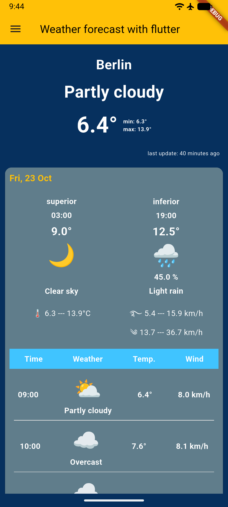
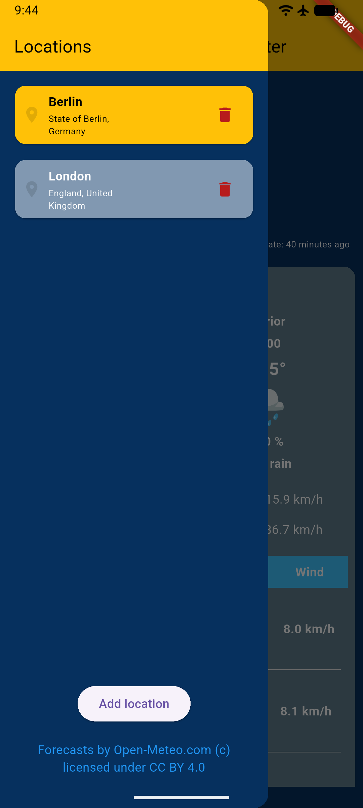

# Weather With Flutter

A compact weather app built with Flutter to demonstrate clean layering, reactive state management and offline-first data handling. It shows a 10-day hourly forecast for a location of your choice and remembers your places between launches.

Weather data is provided by [Open-Meteo](https://open-meteo.com/) (no API key required).

## App Screenshots

### Main Screen

<div align="center">
    
</div>

### Stored Locations

<div align="center">
    
</div>

## Production app

This repository is a showcase project. The same engineering approach is used in the production application **Metevio**:

- App Store: https://apps.apple.com/de/app/metevio-outdoor-weather/id6812420340?l=en-GB
- Google Play: `coming soon`

## Features

- Search for a city or place (Open-Meteo Geocoding API)
- Hourly forecast for up to 10 days, grouped by day: temperature, "feels like", precipitation, wind and gusts
- Multiple saved locations with one active location
- Forecast is cached locally and refreshed at most once per hour
- "Last update" counter

## Tech stack

| Area | Choice | Purpose |
| --- | --- | --- |
| State management & DI | [Riverpod](https://riverpod.dev/) (`flutter_riverpod` 3) | `AsyncNotifier`s hold screen state; providers wire services and database managers together, so every dependency can be replaced in tests |
| Local storage | [Drift](https://drift.simonbinder.eu/) (SQLite) | Caches the weather forecast and persists the list of saved locations and the active one |
| Networking | `http` | Open-Meteo forecast and geocoding APIs |
| Localization | `flutter_localizations`, `intl`, ARB files | Strings generated via `flutter gen-l10n` |
| Logging | `logger` | Custom printer in `lib/tools/logger` |

### How the pieces work together

- **Riverpod** is used for both state management and dependency injection. `lib/app/di.dart` declares the providers for the HTTP client, the weather and geocoding services and the database managers. Notifiers in `lib/services/**/state` read those providers, and widgets in `lib/presentation` only watch notifier state.
- **Drift** is the single source of truth for persisted data: the `LocationTable` stores saved places (including which one is active), and the `WeatherTable` stores the hourly forecast for each location. On start-up the app serves the cached forecast and calls the network only when the cache is empty or older than `AppParams.updateIntervalSec`.

## Architecture

```
lib/
├── app/            # entry point, DI (Riverpod providers), themes
├── db/             # Drift database and managers (LocationManager, ForecastManager)
├── l10n/           # ARB files and generated localizations
├── presentation/   # screens, widgets, formatters
├── services/
│   ├── location/           # geocoding service + location state
│   └── open_weather_service/  # forecast service, domain types, forecast state
└── tools/          # logger, id generator, helpers
```

Data flow: `UI → Notifier (Riverpod) → Service / Manager (interface) → Open-Meteo API / Drift DB`.

Services and managers are exposed as interfaces (`WeatherService`, `GeocodingService`, `LocationManager`, `ForecastManager`) with Open-Meteo and Drift implementations.

## Getting started

Requirements: Flutter with Dart SDK `^3.13.2`.

```bash
git clone https://github.com/drIGunDev/WeatherWithFlutter.git
cd WeatherWithFlutter
flutter pub get
dart run build_runner build --delete-conflicting-outputs   # Drift code generation
flutter gen-l10n                                           # localizations (also run by `flutter run`)
flutter run
```

Supported platforms: Android, iOS, macOS.

### Tests

```bash
flutter test
```

## Data attribution

Weather and geocoding data by [Open-Meteo.com](https://open-meteo.com/), licensed under [CC BY 4.0](https://creativecommons.org/licenses/by/4.0/). Open-Meteo's free API is intended for non-commercial use.

## License

Released under the [MIT License](LICENSE).
